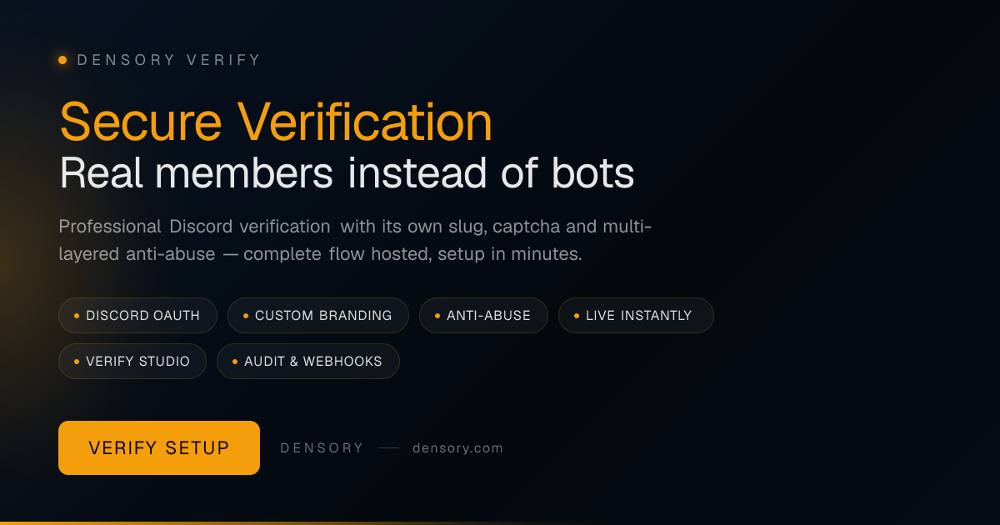

# Densory Verify — Verification & OAuth

 

> OAuth verify page with captcha, anti-abuse and member studio — live in minutes.

Members verify themselves via your own page, automatically receive their role, and optionally go through captcha, VPN protection, and alt filters. You design everything in the dashboard: slug, colors, verify page, and member management — without complicated in-house development.

### 🛒 Get it on the Densory Shop

**[Densory Verify — View in Shop](https://densory.com/shop/densory-verify)**

## Features

- **Discord OAuth** — OAuth2 with encrypted tokens — roles and server join automatically.
- **Custom Branding** — Verify page with its own CSS, banner, cursor and slug — looks like your server, not Densory.
- **Anti-Abuse** — VPN/Tor, Alt-Clusters, Blocklists, Captcha, and Account-Age — multi-layered configurable.
- **Live instantly** — Slug, Credentials, and Verify Panel — ready to use in under 5 minutes from the dashboard.
- **Verify Studio** — Member pool with profiles, shortcuts, and admin servers — GDPR export with a click.
- **Audit & Webhooks** — Role log in Discord, revocation via webhook, health checks — all traceable.

## Prerequisites

- Own Discord application (Client ID, Secret, Bot Token)
- Verified role on your target server
- Bot with Send Messages and Embed Links permission

## Setup

1. **Connect Discord app**
   Store your app data in the dashboard — built-in health checks guide you safely through setup.
2. **Your branding**
   Choose slug, colors, and verify page design — it looks like your server, not a third-party tool.
3. **Activate protection**
   Set captcha, account age, and blocklists as needed — from relaxed to strict.
4. **Going live with the panel**
   Post the Verify panel to your Discord — members click, verify themselves via OAuth, done.

## Configuration

See the full settings reference in [docs/configuration.md](docs/configuration.md).

## Changelog

See [CHANGELOG.md](CHANGELOG.md) and the GitHub Releases tab for the full version history.

## Support & Links

- 🛒 [Shop](https://densory.com/shop/densory-verify)
- 💬 [Discord](https://densory.com/discord)
- ⚙️ [Control Center](https://densory.com/dashboard)

---

_Managed with the Densory Control Center: [https://densory.com/dashboard](https://densory.com/dashboard). Available at [https://densory.com/shop/densory-verify](https://densory.com/shop/densory-verify)._
